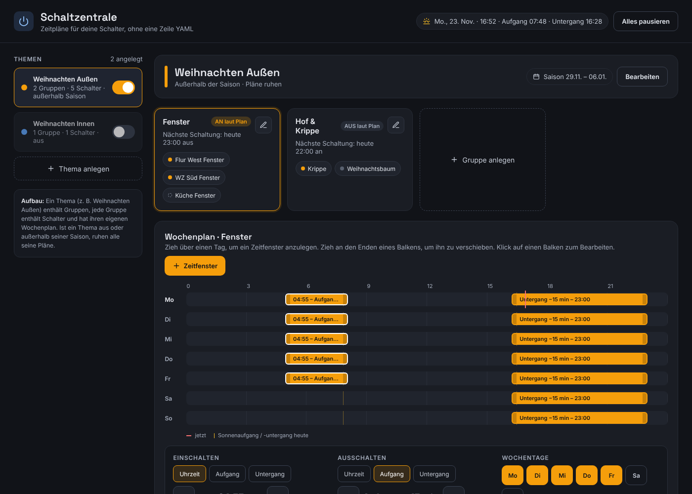
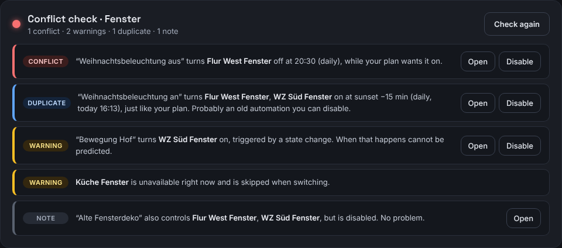
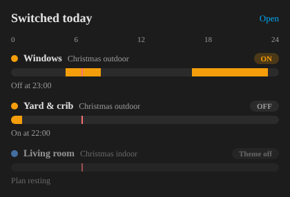

# SwitchPlan

Weekly schedules for your switches in Home Assistant, set up with a few clicks and without a line of YAML.
Made for everything that should turn on and off at fixed times, for example Christmas lights on
Tasmota or Shelly plugs.

> **Use at your own risk.** SwitchPlan switches real devices. It comes without any warranty and the
> authors accept no liability for damage caused by its use. See [Disclaimer](#disclaimer).

The panel and the card are in German when your Home Assistant profile language is German, and in English otherwise.



## How it is organised

| Level | Example | What you set there |
|---|---|---|
| **Theme** | Christmas outdoor | Colour, on/off, season (e.g. 29 Nov to 6 Jan) |
| **Group** | Windows, Yard & crib | Which switches belong to it |
| **Time window** | Mon–Fri 04:55 to sunrise +15 min | Weekdays, turn-on and turn-off time |

* Times are a fixed **clock time** or relative to **sunrise/sunset** (± minutes).
* A time window may run past midnight (e.g. 22:00 to 01:00).
* When a theme is **off**, its switches are turned off and its plans rest.
* Outside its **season** a theme switches nothing.
* **Pause all** freezes everything: nothing is switched. On resume every switch is set to what the plan says.
* Switching happens only when the plan **changes**. If you switch something by hand in between, it stays that way until the next change.
* After a Home Assistant restart all switches are set to the plan once.
* If a switch is in several groups, it stays on as long as one of them wants it on.
* Unavailable devices are skipped.

Works with all entities of the domains `switch`, `light`, `input_boolean` and `fan`.

## Conflict check



Your switches may still be part of older automations. SwitchPlan reads all automations
(including the scenes they activate), works out when they fire and compares that with your plan:

| Level | Meaning |
|---|---|
| **Conflict** | The automation does the opposite of your plan at that time, e.g. turns the lights off at 20:30 while the plan wants them on. |
| **Duplicate** | The automation does the same as your plan. Most likely an old automation you can disable now. |
| **Warning** | It switches the device but the time cannot be predicted (state triggers, toggles, time patterns), or the device is unavailable. |
| **Note** | A disabled automation still mentions the switch. No problem. |

You see the result as a traffic light in the theme header, on each group card, as small markers in the
weekly plan and in detail in the **Conflict check** card below the plan. From there you can open the
automation in the editor or disable it with one click.

## Installation via HACS

1. Open HACS, top right **⋮ → Custom repositories**.
2. Enter `https://github.com/endrei/ha-switchplan`, type **Integration**, add.
3. Search for **SwitchPlan**, download it and restart Home Assistant.
4. **Settings → Devices & services → Add integration → SwitchPlan**.
5. **SwitchPlan** appears in the sidebar. You set up everything there.

Manual install: copy the folder `custom_components/switchplan` to `config/custom_components/` and restart.

### Coming from SwitchManager (0.2.x) or Schaltzentrale (0.1.x)

The project was called Schaltzentrale and then SwitchManager. When updating to 0.3.0:

1. Update in HACS and restart Home Assistant.
2. Delete the old **SwitchManager** (or **Schaltzentrale**) integration entry and add **SwitchPlan**
   (step 4 above). Your themes, groups and plans are imported automatically.
3. Delete the old folder `config/custom_components/switchmanager` (or `schaltzentrale`) if it is
   still there. Otherwise both versions switch your devices.
4. Entity ids change to `switchplan_*`, and the card type is now `custom:switchplan-card`.
   Adjust automations and dashboards that use them.
5. Reload the browser (Ctrl+F5).

## Using the panel

* **Add theme**, then set name, colour and season via **Edit**.
* **Add group**, then search and add switches via the pencil.
* In the **weekly plan**, drag across a day to add a time window. Drag the ends of a bar to move it.
  Click a bar for the details (clock or sun, weekdays, Mon–Fri / Sat–Sun / daily).
  Click a weekday to change just that day.
* Click the hours or minutes of a time to type them; +/- move by 15 minutes.
* Click a switch chip to toggle the device right away.

Everything is saved automatically.

## Entities

The integration creates a device **SwitchPlan** with:

* `switch.switchplan_pause`: on = all plans paused.
* `switch.switchplan_<theme>`: on/off per theme (attributes: `season`, `in_season`).
* `binary_sensor.switchplan_<theme>_<group>`: on while the group is on according to its plan
  (attributes: `reason`, `next_change`, `next_state`, `switches`).

So you can also control SwitchPlan from automations or by voice.

## Dashboard card



The card is loaded automatically. In a dashboard choose **Add card → Manual**:

```yaml
type: custom:switchplan-card
title: Switched today          # optional
theme: Christmas outdoor       # optional, only this theme
```

## Development

```bash
pip install pytest-homeassistant-custom-component
pytest
```

`tests/test_schedule.py` checks the time logic (sun, midnight, season), `tests/test_conflicts.py`
the automation parsing and `tests/test_integration.py` runs switching times and the conflict check
in a test Home Assistant.

## Disclaimer

SwitchPlan is a free hobby project, provided "as is" under the [MIT license](LICENSE), without
warranty of any kind. It switches real devices on and off. You use it at your own risk and are
responsible for what you connect to it and for checking that it works as you expect.

To the extent permitted by law, the authors are not liable for any damage, loss or costs caused by
using SwitchPlan, for example devices that switch at the wrong time or not at all, overheating,
fire, higher energy costs or data loss. Do not use it for devices whose failure could put people,
animals or property at risk (e.g. heating, medical devices, pumps, security systems).

SwitchPlan is not affiliated with or endorsed by Home Assistant or Nabu Casa.
