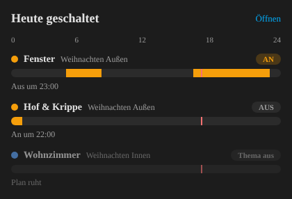

# Schaltzentrale

Zeitpläne für deine Schalter in Home Assistant, per Klick eingerichtet und ohne eine Zeile YAML.
Gedacht für alles, was zu festen Zeiten an- und ausgehen soll, zum Beispiel die Weihnachtsbeleuchtung
an Tasmota- und Shelly-Steckdosen.


## So ist es aufgebaut

| Ebene | Beispiel | Was du dort einstellst |
|---|---|---|
| **Thema** | Weihnachten Außen | Farbe, An/Aus, Saison (z. B. 29.11. bis 06.01.) |
| **Gruppe** | Fenster, Hof & Krippe | Welche Schalter dazugehören |
| **Zeitfenster** | Mo–Fr 04:55 bis Sonnenaufgang +15 min | Wochentage, Einschalt- und Ausschaltzeit |

* Zeiten gehen als feste **Uhrzeit** oder relativ zu **Sonnenaufgang/-untergang** (± Minuten).
* Ein Zeitfenster darf über Mitternacht gehen (z. B. 22:00 bis 01:00).
* Ist ein Thema **aus**, werden seine Schalter ausgeschaltet und seine Pläne ruhen.
* Außerhalb der **Saison** schaltet ein Thema nichts.
* **Alles pausieren** friert alles ein: Es wird nichts geschaltet. Beim Fortsetzen wird jeder Schalter auf den Stand laut Plan gebracht.
* Geschaltet wird nur bei einem **Wechsel** laut Plan. Schaltest du zwischendurch etwas von Hand, bleibt das so bis zum nächsten Wechsel.
* Nach einem Neustart von Home Assistant werden alle Schalter einmal auf den Planstand gebracht.
* Steckt ein Schalter in mehreren Gruppen, bleibt er an, solange eine davon ihn an haben will.
* Nicht erreichbare Geräte werden übersprungen.

Funktioniert mit allen Entitäten der Domänen `switch`, `light`, `input_boolean` und `fan`.

## Installation über HACS

1. HACS öffnen, oben rechts **⋮ → Benutzerdefinierte Repositories**.
2. `https://github.com/endrei/ha-switchmanager` eintragen, Typ **Integration**, hinzufügen.
3. **Schaltzentrale** suchen und herunterladen, dann Home Assistant neu starten.
4. **Einstellungen → Geräte & Dienste → Integration hinzufügen → Schaltzentrale**.
5. In der Seitenleiste erscheint **Schaltzentrale**. Dort legst du alles an.

Manuell geht es auch: den Ordner `custom_components/schaltzentrale` nach `config/custom_components/` kopieren und neu starten.

## Bedienung im Panel

* **Thema anlegen**, dann über **Bearbeiten** Name, Farbe und Saison setzen.
* **Gruppe anlegen**, über den Stift Schalter suchen und hinzufügen.
* Im **Wochenplan** mit der Maus über einen Tag ziehen, um ein Zeitfenster anzulegen. An den Enden eines Balkens ziehen, um ihn zu verschieben. Ein Klick auf einen Balken öffnet die Feineinstellung (Uhrzeit oder Sonne, Wochentage, Mo–Fr / Sa–So / täglich).
* Ein Klick auf einen Schalter-Chip schaltet das Gerät sofort von Hand um.

Alles wird automatisch gespeichert.

## Entitäten

Die Integration legt ein Gerät **Schaltzentrale** an mit:

* `switch.schaltzentrale_pause`: An = alle Pläne pausiert.
* `switch.schaltzentrale_<thema>`: An/Aus je Thema (Attribute: Saison, in_saison).
* `binary_sensor.schaltzentrale_<thema>_<gruppe>`: An, wenn die Gruppe laut Plan gerade an ist
  (Attribute: grund, naechste_schaltung, naechster_zustand, schalter).

Damit kannst du die Schaltzentrale auch aus Automationen oder per Sprache steuern.

## Dashboard-Karte



Die Karte wird automatisch mitgeladen. Im Dashboard **Karte hinzufügen → Manuell**:

```yaml
type: custom:schaltzentrale-card
title: Heute geschaltet        # optional
theme: Weihnachten Außen       # optional, nur dieses Thema
```

## Entwicklung

```bash
pip install pytest-homeassistant-custom-component
pytest
```

`tests/test_schedule.py` prüft die Zeitlogik (Sonne, Mitternacht, Saison), `tests/test_integration.py`
spielt Schaltzeiten in einem Test-Home-Assistant durch.
